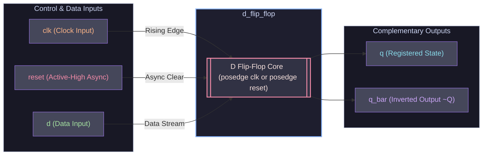
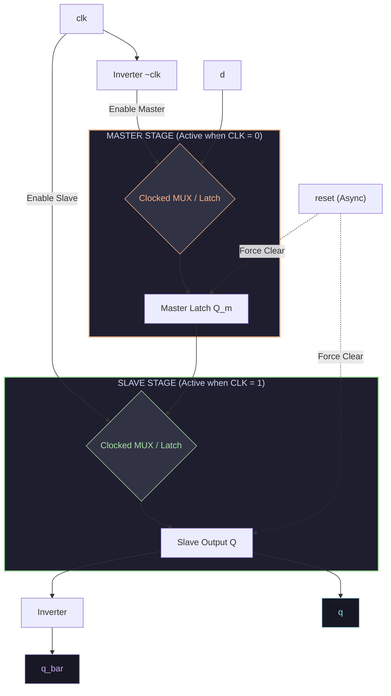
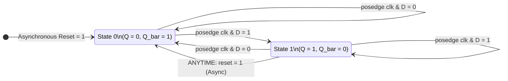

# ⚡ Positive-Edge D Flip-Flop with Asynchronous Reset

[](d_flip_flop.v)
[](https://www.intel.com/content/www/us/en/software/programmable/quartus-prime/modelsim.html)
[](tb_d_flip_flop.v)
[](d_flip_flop.v)
[](LICENSE)

An industrial-grade, fully synthesizable Verilog implementation of a **Positive-Edge Triggered D (Data / Delay) Flip-Flop** featuring an **Active-High Asynchronous Reset** and complementary outputs ($Q$ and $\bar{Q}$). Complete with a self-contained ModelSim / QuestaSim testbench validating both synchronous sampling and asynchronous reset override conditions.

---

## 📑 Table of Contents

- [📌 Key Features](#-key-features)
- [📐 Schematics & Architecture](#-schematics--architecture)
  - [1. Top-Level Module Interface](#1-top-level-module-interface)
  - [2. Internal Master-Slave Gate-Level Schematic](#2-internal-master-slave-gate-level-schematic)
  - [3. RTL Hardware Logic (Multiplexer Model)](#3-rtl-hardware-logic-multiplexer-model)
- [🔄 State & Logic Representation](#-state--logic-representation)
  - [Truth / Function Table](#truth--function-table)
  - [Excitation Table](#excitation-table)
  - [State Transition Diagram](#state-transition-diagram)
- [⏱️ Timing & Waveform Analysis](#️-timing--waveform-analysis)
  - [ASCII Simulation Timing Diagram](#ascii-simulation-timing-diagram)
  - [Testbench Execution Flow](#testbench-execution-flow)
- [📂 Project Structure](#-project-structure)
- [🚀 Quick Start & Simulation Guide](#-quick-start--simulation-guide)
  - [Option A: ModelSim / QuestaSim GUI & CLI](#option-a-modelsim--questasim-gui--cli)
  - [Option B: Open-Source Icarus Verilog + GTKWave](#option-b-open-source-icarus-verilog--gtkwave)
- [🔍 Deep-Dive: Timing Constraints & Physics](#-deep-dive-timing-constraints--physics)
- [📜 License](#-license)

---

## 📌 Key Features

* **Edge-Triggered Synchronous Sampling:** Latching occurs strictly on the rising edge (`posedge clk`) of the clock signal.
* **Instantaneous Asynchronous Reset:** Active-high `reset` overrides all clocking actions immediately, forcing output $Q \to 0$ without waiting for a clock edge.
* **Dual Complementary Outputs:** Produces both non-inverted output `q` and inverted output `q_bar` ($\bar{Q}$) using continuous assignment `assign q_bar = ~q;`.
* **Zero Glitch / Race-Free RTL:** Implemented via non-blocking assignments (`<=`) adhering to IEEE 1364 standard HDL best practices.
* **Target Agnostic:** Fully compatible with Intel Quartus Prime, Xilinx Vivado, Lattice Diamond, ModelSim, QuestaSim, and Icarus Verilog.

---

## 📐 Schematics & Architecture

### 1. Top-Level Module Interface

The module wraps high-speed sequential logic with standard synchronous digital interfaces:



---

### 2. Internal Master-Slave Gate-Level Schematic

To eliminate race conditions and achieve edge sensitivity, a D flip-flop is conventionally realized via a **Master-Slave** topology with asynchronous clear gates:



---

### 3. RTL Hardware Logic (Multiplexer Model)

In synthesized hardware (e.g. standard cell ASIC or FPGA logic element), the behavior is mapped into a multiplexed feedback register:

```
                  +-----------------------------------+
                  |                                   |
                  v                                   |
  D ---->[0]\                                         |
         |   |---( D_next )--->[0]\                   |
  0 ---->[1]/                  |   |--->[ D-REG ]-----+---> Q
           ^                   |   |      ^
           |            0 ---->[1]/       | clk (posedge)
         (reset)                 ^        +-- [CLR] <-- reset (async)
                                 |
                          (hold/latch)
```

---

## 🔄 State & Logic Representation

### Truth / Function Table

| `reset` (Async) | `clk` | `d` (Input) | $Q_{next}$ (Output) | $\bar{Q}_{next}$ (Output) | Operation Mode |
|:---:|:---:|:---:|:---:|:---:|:---|
| **`1`** | `X` (Don't Care) | `X` | **`0`** | **`1`** | **Asynchronous Reset (Immediate Force 0)** |
| `0` | `0` or `1` (No Edge) | `X` | $Q$ | $\bar{Q}$ | **Memory / Hold State (No Change)** |
| `0` | `↓` (Falling Edge) | `X` | $Q$ | $\bar{Q}$ | **Inactive Clock Edge (No Change)** |
| `0` | `↑` (Rising Edge)  | **`0`** | **`0`** | **`1`** | **Synchronous Reset / Latch 0** |
| `0` | `↑` (Rising Edge)  | **`1`** | **`1`** | **`0`** | **Synchronous Set / Latch 1** |

> **Characteristic Equation:**  
> $$Q_{next} = \overline{reset} \cdot D$$

---

### Excitation Table

Specifies the required input `D` to cause a transition from present state $Q(t)$ to next state $Q(t+1)$ under normal operation ($Reset = 0$):

| Present State $Q(t)$ | Next State $Q(t+1)$ | Input $D$ Required | Transition Name |
|:---:|:---:|:---:|:---|
| `0` | `0` | **`0`** | No change (Low) |
| `0` | `1` | **`1`** | Set to High |
| `1` | `0` | **`0`** | Reset to Low |
| `1` | `1` | **`1`** | No change (High) |

---

### State Transition Diagram



---

## ⏱️ Timing & Waveform Analysis

### ASCII Simulation Timing Diagram

The testbench clock runs with a period of **10 ns** (5 ns Low / 5 ns High). Here is the exact cycle-accurate timeline verified in `tb_d_flip_flop.v`:

```text
Time (ns): 0       10      20      30      40      50   53  58       78
           |-------|-------|-------|-------|-------|-----|---|--------|
           
clk        __--__--__--__--__--__--__--__--__--__--__--__--__--__--__--
              ^       ^       ^       ^       ^       ^       ^
              10ns    20ns    30ns    40ns    50ns    60ns    70ns

reset      --------___________________________________-----___________
           |<Init> |<--- Normal Synchronous Mode ---->|Async Pulse|

d          ________________--------________--------___________________
           |  d=0  |  d=0  |  d=1  |  d=0  |  d=1  |  d=0  |   d=0    |

q          ________________--------________--------___________________
           |   0   |   0   |   1   |   0   |   1   | 0 (immediate)    |

q_bar      ----------------________--------________-------------------
           |   1   |   1   |   0   |   1   |   0   | 1 (immediate)    |
```

### Testbench Execution Flow

| Time (ns) | Event Description | Clock State | Input `d` | Input `reset` | Output `q` | Output `q_bar` | Observation |
|---|---|:---:|:---:|:---:|:---:|:---:|---|
| **0 - 10** | **System Initialization** | Oscillating | `0` | `1` | `0` | `1` | Asynchronous reset holds $Q=0$. |
| **10** | **Reset Released** | `posedge` | `0` | `0` | `0` | `1` | Normal clocked operation commences. |
| **20** | **Test Case 1** | `posedge` | `1` | `0` | **`1`** | **`0`** | $D=1$ sampled on clock edge; $Q \to 1$. |
| **30** | **Test Case 2** | `posedge` | `0` | `0` | **`0`** | **`1`** | $D=0$ sampled on clock edge; $Q \to 0$. |
| **40** | **Test Case 3** | `posedge` | `1` | `0` | **`1`** | **`0`** | $D=1$ sampled on clock edge; $Q \to 1$. |
| **50** | **Test Case 4** | `posedge` | `0` | `0` | **`0`** | **`1`** | $D=0$ sampled on clock edge; $Q \to 0$. |
| **53** | **Async Reset Pulse** | Mid-cycle (`clk=0`) | `0` | **`1`** | **`0`** | **`1`** | **Async reset kicks in immediately!** |
| **58** | **Async Reset Clear** | Mid-cycle (`clk=1`) | `0` | `0` | `0` | `1` | Reset returns to idle without glitching. |
| **78** | **Simulation End** | - | - | - | - | - | `$finish` called. |

---

## 📂 Project Structure

```bash
d_flip_flop/
├── .gitignore         # Ignores ModelSim work library, WLF waveforms, & compiler logs
├── README.md          # Interactive design manual, schematics, and simulation notes
├── d_flip_flop.v      # Synthesizable RTL description of D Flip-Flop
└── tb_d_flip_flop.v   # Complete self-verifying testbench with timing stimuli
```

---

## 🚀 Quick Start & Simulation Guide

### Option A: ModelSim / QuestaSim GUI & CLI

<details>
<summary>▶ <b>Click to expand ModelSim step-by-step instructions</b></summary>

#### Command-Line Execution (Fast):

Open your terminal or ModelSim command prompt inside the project directory:

```bash
# 1. Create the working library
vlib work

# 2. Compile RTL and Testbench files
vlog d_flip_flop.v tb_d_flip_flop.v

# 3. Launch console-mode simulation
vsim -c -do "run -all; quit" tb_d_flip_flop
```

#### GUI Interactive Execution:

```bash
# Launch ModelSim with GUI and wave viewer
vsim -gui tb_d_flip_flop
```

Inside the ModelSim GUI console, load and view signals:
```tcl
add wave -position insertpoint sim:/tb_d_flip_flop/*
run -all
wave zoomfull
```

</details>

---

### Option B: Open-Source Icarus Verilog + GTKWave

<details>
<summary>▶ <b>Click to expand Icarus Verilog commands</b></summary>

If you are working on a machine without ModelSim:

```bash
# 1. Compile with iverilog
iverilog -o dff_sim.vvp d_flip_flop.v tb_d_flip_flop.v

# 2. Execute simulation
vvp dff_sim.vvp

# 3. View waveforms (if $dumpfile/$dumpvars is enabled)
gtkwave dump.vcd
```

</details>

---

## 🔍 Deep-Dive: Timing Constraints & Physics

When deploying this D flip-flop design into real-world FPGA/ASIC hardware:

```
           ______                      ______
clk  _____/      \____________________/      \_____
             <--->                     <--->
             t_su                      t_h
        _____                              ________
d   ___/     \____________________________/
             |                             |
             |<-- Stable Data Window ----->|
```

* **Setup Time ($t_{su}$):** Minimum duration the input signal `d` must remain stable **before** the active clock edge.
* **Hold Time ($t_h$):** Minimum duration the input signal `d` must remain stable **after** the active clock edge.
* **Clock-to-Q Delay ($t_{cq}$):** Time required for output `q` to reach a valid logic level following the rising clock edge.
* **Recovery & Removal Time:** For the asynchronous `reset`, recovery time ($t_{rec}$) ensures reset de-assertion does not violate the next clock setup window, preventing metastability.

---

## 💻 Source Code Reference

<details>
<summary><b>View RTL Source: <code>d_flip_flop.v</code></b></summary>

```verilog
module d_flip_flop (
    input wire clk,
    input wire reset,
    input wire d,
    output reg q,
    output wire q_bar
);

    // Positive-edge triggered D Flip-Flop with asynchronous active-high reset
    always @(posedge clk or posedge reset) begin
        if (reset)
            q <= 1'b0;
        else
            q <= d;
    end

    assign q_bar = ~q;

endmodule
```

</details>

<details>
<summary><b>View Testbench Source: <code>tb_d_flip_flop.v</code></b></summary>

```verilog
`timescale 1ns/1ps

module tb_d_flip_flop;

    reg clk;
    reg reset;
    reg d;

    wire q;
    wire q_bar;

    // Instantiate the D Flip-Flop
    d_flip_flop uut (
        .clk(clk),
        .reset(reset),
        .d(d),
        .q(q),
        .q_bar(q_bar)
    );

    // Clock generation: 10 ns period
    always #5 clk = ~clk;

    // Apply test cases
    initial begin

        // Initialize signals
        clk = 0;
        reset = 1;
        d = 0;

        // Release reset
        #10 reset = 0;

        // Test Case 1: D = 1
        #10 d = 1;

        // Test Case 2: D = 0
        #10 d = 0;

        // Test Case 3: D = 1
        #10 d = 1;

        // Test Case 4: D = 0
        #10 d = 0;

        // Test asynchronous reset
        #3 reset = 1;
        #5 reset = 0;

        // Finish simulation
        #20 $finish;

    end

endmodule
```

</details>

---

## 📜 License

This project is open-source and released under the [MIT License](LICENSE). Feel free to use, modify, and distribute it for academic and industrial projects.
